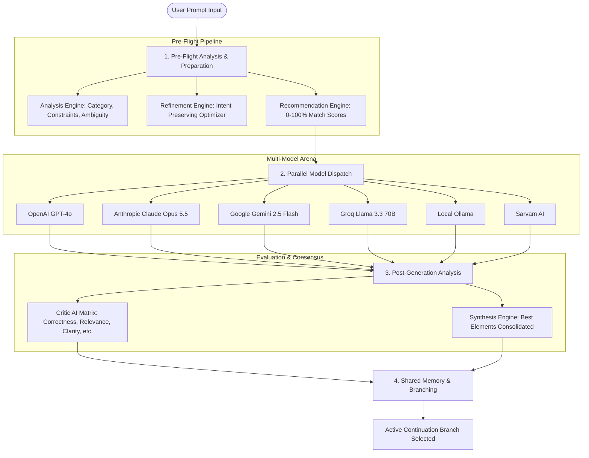

# FUSION AI — Backend Architecture & Implementation Documentation

**Fusion AI** is an intelligent orchestration layer and multi-LLM workspace backend built with **Node.js** and **Express**. It handles prompt analysis, automated prompt refinement, dynamic model recommendation, parallel multi-model dispatching, Critic AI evaluation, consensus synthesis, and provider-neutral branching conversation memory.

---

## 1. System Architecture & High-Level Flow



---

## 2. Directory Structure & File Map

| Path | Purpose | Key Responsibilities |
|---|---|---|
| [`server/server.js`](file:///c:/Users/bhava/OneDrive/Desktop/Akash/server/server.js) | Main Express API Server | Express configuration, middleware, CORS, Multer uploads, route handlers |
| [`server/config/models.js`](file:///c:/Users/bhava/OneDrive/Desktop/Akash/server/config/models.js) | Configuration Store | Model registry, capability benchmarks, token pricing, default Critic weights |
| [`server/services/analysisEngine.js`](file:///c:/Users/bhava/OneDrive/Desktop/Akash/server/services/analysisEngine.js) | Prompt Analysis Engine | Intent classification, confidence score distributions, tech stack & ambiguity detection |
| [`server/services/refinementEngine.js`](file:///c:/Users/bhava/OneDrive/Desktop/Akash/server/services/refinementEngine.js) | Prompt Refinement Engine | High-performance prompt rewriting, step breakdown, and edge-case injection |
| [`server/services/recommendationEngine.js`](file:///c:/Users/bhava/OneDrive/Desktop/Akash/server/services/recommendationEngine.js) | Recommendation Engine | Weighted suitability scoring (0–100%) and explainable match rationales |
| [`server/services/llmService.js`](file:///c:/Users/bhava/OneDrive/Desktop/Akash/server/services/llmService.js) | LLM Dispatch Service | Parallel multi-provider execution, API adapters, resilience & live connection tests |
| [`server/services/criticEngine.js`](file:///c:/Users/bhava/OneDrive/Desktop/Akash/server/services/criticEngine.js) | Critic AI Engine | 5-factor weighted evaluation matrix, pros/cons extraction, winner selection |
| [`server/services/synthesisService.js`](file:///c:/Users/bhava/OneDrive/Desktop/Akash/server/services/synthesisService.js) | Consensus Synthesis | Merges the best parts across all models into a single consolidated response |
| [`server/services/memoryService.js`](file:///c:/Users/bhava/OneDrive/Desktop/Akash/server/services/memoryService.js) | Conversation & Memory | Branch selection, alternative branch retention, multi-turn context serialization |
| [`server/services/documentService.js`](file:///c:/Users/bhava/OneDrive/Desktop/Akash/server/services/documentService.js) | Document Parser | Text extraction and chunking for PDF, DOCX, and TXT files |
| [`server/verify-e2e.js`](file:///c:/Users/bhava/OneDrive/Desktop/Akash/server/verify-e2e.js) | Automated Test Suite | E2E test runner validating all backend endpoints and pipelines |

---

## 3. Core Engine Mechanics

### 3.1 Prompt Analysis Engine
- **Classification Categories**: `Coding`, `Logical Reasoning`, `Creative Writing`, `Summarization`, `Documentation`, `General QA`.
- **Constraint Detection**: Identifies target languages (Python, TypeScript, SQL, etc.), output structures (JSON schema, markdown tables), and negative constraints.
- **Ambiguity Scoring**: Evaluates prompt clarity (0–100%) and highlights missing parameters.

### 3.2 Prompt Refinement & Decomposition
- **Rewriting**: Replaces ambiguous terms with unambiguous instructions, sets performance and runtime requirements, and defines output formats.
- **Reasoning Checklist**: Deconstructs prompt into sequential execution steps.
- **Improvement Explanations**: Provides transparent reasons for why each modification was added.

### 3.3 Dynamic Model Recommendation
- Computes match scores using weighted task capability benchmarks, context window requirements, latency sensitivity, and cost efficiency.
- Assigns specific roles: `Best Primary Model`, `Speed Champion`, `Budget Pick`.

### 3.4 Multi-LLM Dispatch & Execution
- Fires non-blocking parallel HTTP requests with timeouts and error isolation.
- Converts unified prompt and history objects into provider-specific payloads (OpenAI Chat format, Anthropic Messages format, Google Gemini Content format).

### 3.5 Evidence-Based Evaluation Agent (Upgraded Critic AI)
The evaluation system operates as a hybrid multi-layer architecture:
1. **Deterministic Rule Validation (`server/services/evaluation/ruleValidator.js`)**:
   - Weight validation and normalization (finite, non-negative, normalized to 1.0).
   - Verifies empty, truncated, or malformed responses.
   - Enforces exact JSON/schema formatting.
   - Strict negative constraint checking (e.g. prohibited external libraries, prohibited recursion).
   - Incomplete generation detection (unclosed code fences, cut-offs).
2. **Task-Specific Verification (`server/services/evaluation/taskValidators.js`)**:
   - `CodingTaskValidator`: code-fence checks, static syntax delimiter validation, edge-case inspection, and explicit sandbox disclaimer (never claims execution when isolated sandboxing was unperformed).
   - `ResearchTaskValidator`: checks assertions against supplied document context; unsupported claims without evidence are marked as `unverified` / `insufficient_evidence`, not false.
   - `SummarizationTaskValidator`: source material vocabulary overlap and executive bullet-point structure.
   - `GeneralReasoningValidator`: logical consistency and formatting.
3. **Requirement Coverage Analysis (`server/services/evaluation/requirementAnalyzer.js`)**:
   - Extracts discrete requirements from original prompt and constraints.
   - Detects prompt-refinement conflicts where refinement altered original intent.
   - Calculates discrete requirement satisfaction percentages.
4. **Root-Cause Diagnostics (`server/services/evaluation/diagnostics.js`)**:
   - Structured categories: `factual_error`, `unsupported_claim`, `logical_contradiction`, `missing_requirement`, `instruction_violation`, `format_violation`, `incomplete_response`, `code_validation_failure`, `insufficient_evidence`, `provider_error`, `evaluation_error`.
   - Stage attribution: `prompt_refinement`, `decision_model`, `provider_or_execution`, `evaluation_agent`, `input_or_context`, `unknown`.
5. **LLM-as-a-Judge Layer (`server/services/evaluation/llmJudge.js`)**:
   - Independent evaluator prompt with prompt injection resistance (untrusted candidate content directive).
   - Anchored rubric scoring across 5 dimensions: Correctness (35%), Relevance (20%), Completeness (20%), Clarity (15%), Instruction Following (10%).
   - Graceful fallback to degraded / deterministic-only mode if external LLM judge is disabled or fails.
6. **Controlled Revision Loop (`server/services/evaluation/revisionLoop.js`)**:
   - Bounded evaluation feedback with max 2 retry attempts.
   - Routes corrections to refinement or generation depending on root-cause attribution.
7. **Synthesis Verification (`server/services/synthesisService.js`)**:
   - Eliminates hardcoded or fabricated claims.
   - Independently assesses synthesized consensus against user prompt requirements.

### 3.6 Provider-Neutral Memory & Branching
- Avoids provider lock-in by storing conversation turns as neutral state objects.
- Allows users to select any response branch to continue the conversation while retaining access to alternative branches.
- Measures empirical user alignment with critic recommendations in telemetry.

---

## 4. REST API Endpoint Reference

| Method | Endpoint | Description |
|---|---|---|
| `POST` | `/api/preflight-prompt` | Runs Analysis, Refinement, and Recommendation in 1 roundtrip |
| `POST` | `/api/analyze-prompt` | Analyzes category, constraints, and ambiguity |
| `POST` | `/api/refine-prompt` | Refines prompt and generates step-by-step checklist |
| `POST` | `/api/recommend-models` | Computes model suitability scores |
| `POST` | `/api/generate` | Dispatches parallel queries across selected LLMs |
| `POST` | `/api/critic-evaluate` | Computes evidence-based Critic AI evaluation matrix & diagnostics |
| `POST` | `/api/synthesize` | Generates verified consensus response with quality scoring |
| `POST` | `/api/upload` | Ingests PDF / DOCX / TXT documents |
| `GET` | `/api/models` | Lists configured model registry & scoring weights |
| `POST` | `/api/models/update` | Updates active models or Critic weights |
| `POST` | `/api/models/test` | Tests live connectivity for a specific model |
| `GET` | `/api/settings/keys/status` | Reports configured provider API key statuses |
| `POST` | `/api/settings/keys` | Updates runtime provider API keys |
| `GET` | `/api/conversations` | Lists conversation sessions |
| `POST` | `/api/conversations` | Creates a new conversation session |
| `GET` | `/api/conversations/:id` | Fetches full conversation tree & turns |
| `POST` | `/api/conversations/:id/turn` | Adds a new turn with multi-model candidate responses |
| `POST` | `/api/conversations/:id/branch` | Selects active continuation branch |
| `POST` | `/api/conversations/:id/synthesis`| Saves consensus synthesis to turn |
| `GET` | `/api/stats` | Returns latency, model usage, evaluation quality, and selection telemetry |

---

## 5. Verification & Testing

To run the automated 20-scenario deterministic evaluation test suite (runs 100% offline without API keys):
```bash
npm test
```

To run the full live end-to-end workflow verification (requires backend server running on port 5050):
```bash
node server/verify-e2e.js
```

