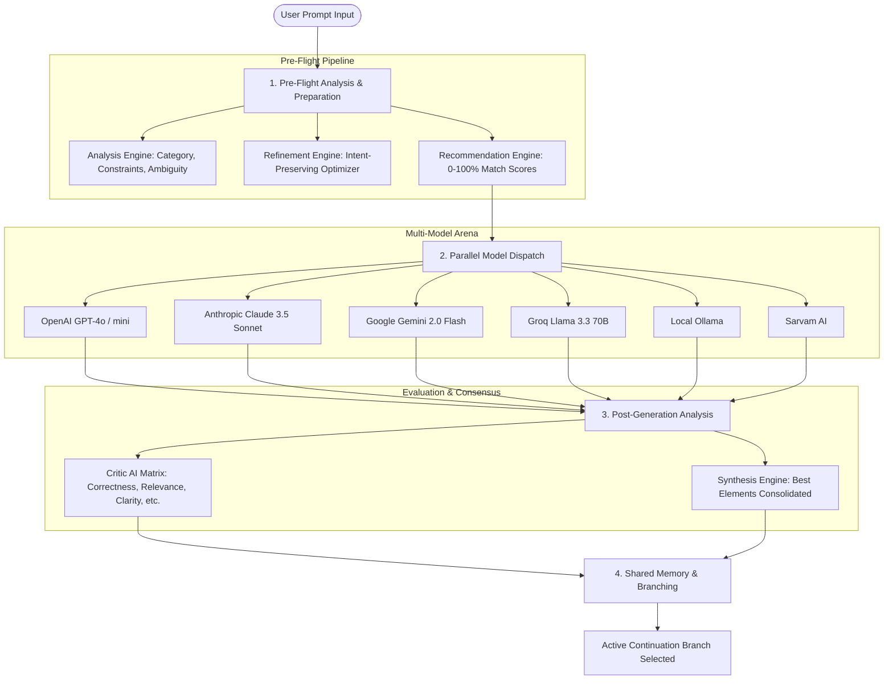

# AI HIVE MIND — Backend Architecture & Implementation Documentation

**AI Hive Mind** is an intelligent orchestration layer and multi-LLM workspace backend built with **Node.js** and **Express**. It handles prompt analysis, automated prompt refinement, dynamic model recommendation, parallel multi-model dispatching, Critic AI evaluation, consensus synthesis, and provider-neutral branching conversation memory.

---

## 1. System Architecture & High-Level Flow



---

## 2. Directory Structure & File Map

| Path | Purpose | Key Responsibilities |
|---|---|---|
| [`server/server.js`](file:///c:/Users/bhava/OneDrive/Desktop/Akash/server/server.js) | Main Express API Server | Express configuration, middleware, CORS, Multer uploads, route handlers |
| [`server/config/models.js`](file:///c:/Users/bhava/OneDrive/Desktop/Akash/server/config/models.js) | Configuration Store | Model registry, capability benchmarks, token pricing, default Critic weights |
| [`server/services/analysisEngine.js`](file:///c:/Users/bhava/OneDrive/Desktop/Akash/server/services/analysisEngine.js) | Prompt Analysis Engine | Intent classification, confidence score distributions, tech stack & ambiguity detection |
| [`server/services/refinementEngine.js`](file:///c:/Users/bhava/OneDrive/Desktop/Akash/server/services/refinementEngine.js) | Prompt Refinement Engine | High-performance prompt rewriting, step breakdown, and edge-case injection |
| [`server/services/recommendationEngine.js`](file:///c:/Users/bhava/OneDrive/Desktop/Akash/server/services/recommendationEngine.js) | Recommendation Engine | Weighted suitability scoring (0–100%) and explainable match rationales |
| [`server/services/llmService.js`](file:///c:/Users/bhava/OneDrive/Desktop/Akash/server/services/llmService.js) | LLM Dispatch Service | Parallel multi-provider execution, API adapters, resilience & live connection tests |
| [`server/services/criticEngine.js`](file:///c:/Users/bhava/OneDrive/Desktop/Akash/server/services/criticEngine.js) | Critic AI Engine | 5-factor weighted evaluation matrix, pros/cons extraction, winner selection |
| [`server/services/synthesisService.js`](file:///c:/Users/bhava/OneDrive/Desktop/Akash/server/services/synthesisService.js) | Consensus Synthesis | Merges the best parts across all models into a single consolidated response |
| [`server/services/memoryService.js`](file:///c:/Users/bhava/OneDrive/Desktop/Akash/server/services/memoryService.js) | Conversation & Memory | Branch selection, alternative branch retention, multi-turn context serialization |
| [`server/services/documentService.js`](file:///c:/Users/bhava/OneDrive/Desktop/Akash/server/services/documentService.js) | Document Parser | Text extraction and chunking for PDF, DOCX, and TXT files |
| [`server/verify-e2e.js`](file:///c:/Users/bhava/OneDrive/Desktop/Akash/server/verify-e2e.js) | Automated Test Suite | E2E test runner validating all backend endpoints and pipelines |

---

## 3. Core Engine Mechanics

### 3.1 Prompt Analysis Engine
- **Classification Categories**: `Coding`, `Logical Reasoning`, `Creative Writing`, `Summarization`, `Documentation`, `General QA`.
- **Constraint Detection**: Identifies target languages (Python, TypeScript, SQL, etc.), output structures (JSON schema, markdown tables), and negative constraints.
- **Ambiguity Scoring**: Evaluates prompt clarity (0–100%) and highlights missing parameters.

### 3.2 Prompt Refinement & Decomposition
- **Rewriting**: Replaces ambiguous terms with unambiguous instructions, sets performance and runtime requirements, and defines output formats.
- **Reasoning Checklist**: Deconstructs prompt into sequential execution steps.
- **Improvement Explanations**: Provides transparent reasons for why each modification was added.

### 3.3 Dynamic Model Recommendation
- Computes match scores using weighted task capability benchmarks, context window requirements, latency sensitivity, and cost efficiency.
- Assigns specific roles: `Best Primary Model`, `Speed Champion`, `Budget Pick`.

### 3.4 Multi-LLM Dispatch & Execution
- Fires non-blocking parallel HTTP requests with timeouts and error isolation.
- Converts unified prompt and history objects into provider-specific payloads (OpenAI Chat format, Anthropic Messages format, Google Gemini Content format).

### 3.5 Critic AI Evaluation
- Scores responses across 5 standardized metrics:
  - **Correctness** (35%)
  - **Relevance** (20%)
  - **Completeness** (20%)
  - **Clarity** (15%)
  - **Instruction Following** (10%)
- Computes composite weighted scores and highlights strengths and weaknesses for each output.

### 3.6 Provider-Neutral Memory & Branching
- Avoids provider lock-in by storing conversation turns as neutral state objects.
- Allows users to select any response branch to continue the conversation while retaining access to alternative branches.

---

## 4. REST API Endpoint Reference

| Method | Endpoint | Description |
|---|---|---|
| `POST` | `/api/preflight-prompt` | Runs Analysis, Refinement, and Recommendation in 1 roundtrip |
| `POST` | `/api/analyze-prompt` | Analyzes category, constraints, and ambiguity |
| `POST` | `/api/refine-prompt` | Refines prompt and generates step-by-step checklist |
| `POST` | `/api/recommend-models` | Computes model suitability scores |
| `POST` | `/api/generate` | Dispatches parallel queries across selected LLMs |
| `POST` | `/api/critic-evaluate` | Computes 5-dimension Critic AI evaluation matrix |
| `POST` | `/api/synthesize` | Generates consolidated consensus response |
| `POST` | `/api/upload` | Ingests PDF / DOCX / TXT documents |
| `GET` | `/api/models` | Lists configured model registry & scoring weights |
| `POST` | `/api/models/update` | Updates active models or Critic weights |
| `POST` | `/api/models/test` | Tests live connectivity for a specific model |
| `GET` | `/api/settings/keys/status` | Reports configured provider API key statuses |
| `POST` | `/api/settings/keys` | Updates runtime provider API keys |
| `GET` | `/api/conversations` | Lists conversation sessions |
| `POST` | `/api/conversations` | Creates a new conversation session |
| `GET` | `/api/conversations/:id` | Fetches full conversation tree & turns |
| `POST` | `/api/conversations/:id/turn` | Adds a new turn with multi-model candidate responses |
| `POST` | `/api/conversations/:id/branch` | Selects active continuation branch |
| `POST` | `/api/conversations/:id/synthesis`| Saves consensus synthesis to turn |
| `GET` | `/api/stats` | Returns latency, model usage, and selection telemetry |

---

## 5. Verification & Testing

To run the automated end-to-end test suite:
```bash
node server/verify-e2e.js
```
